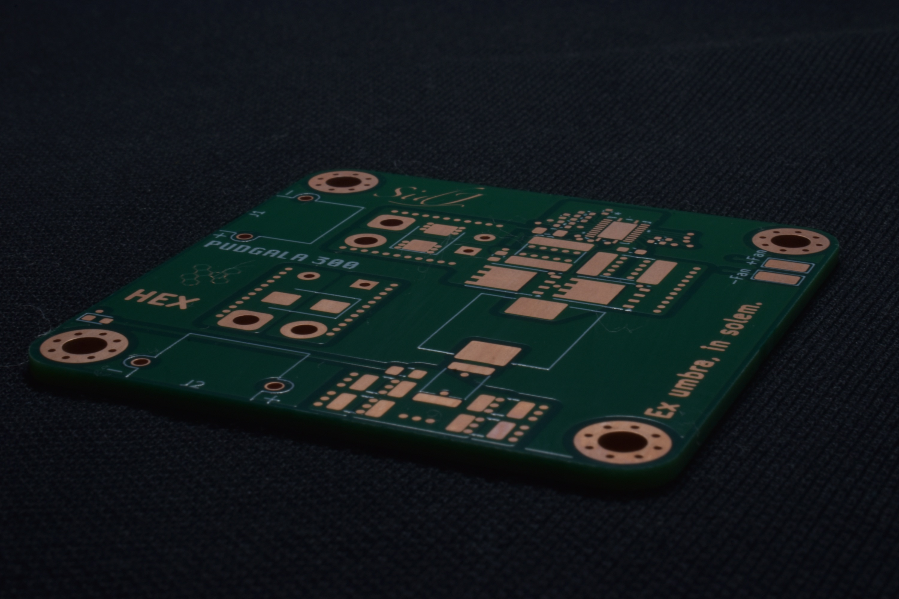
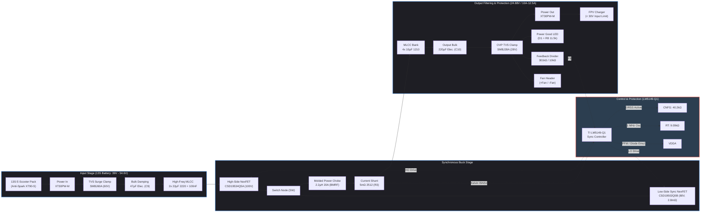
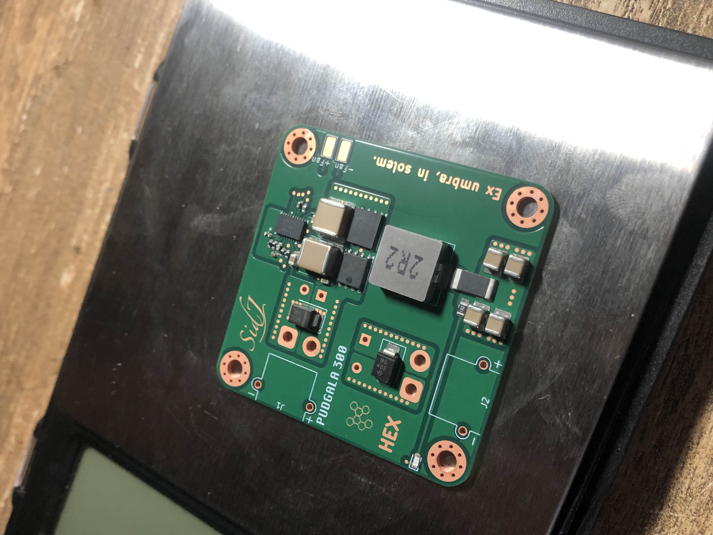
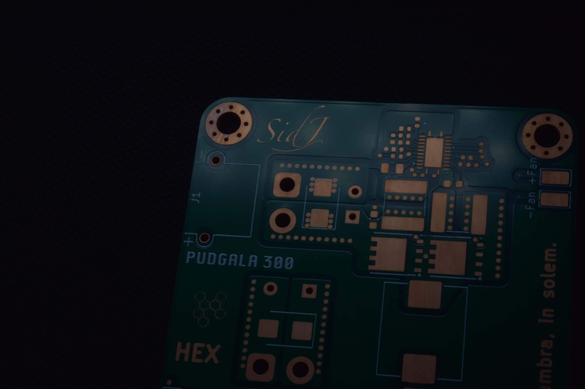
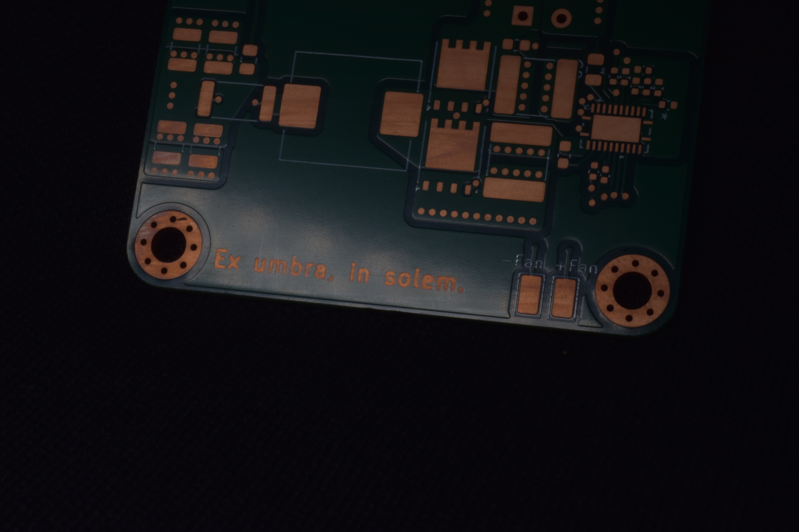
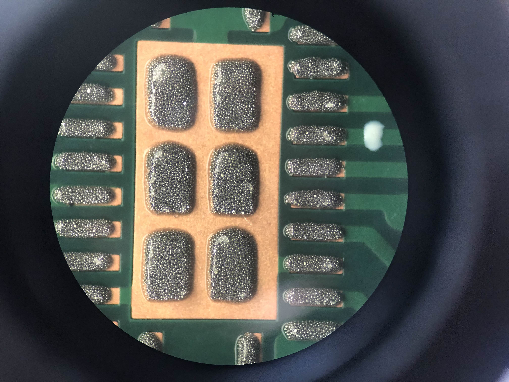
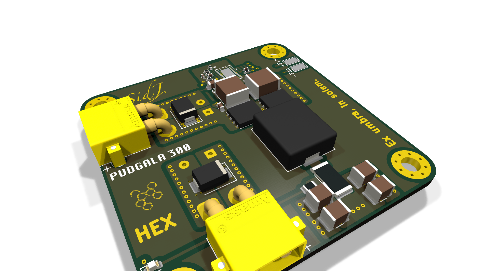
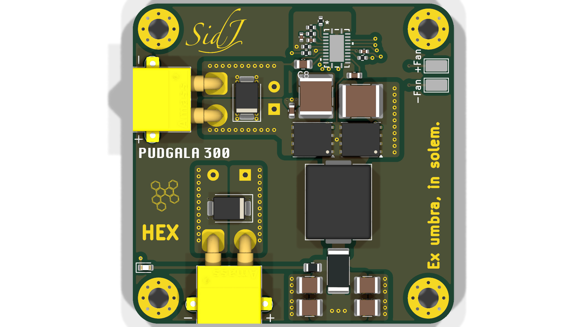
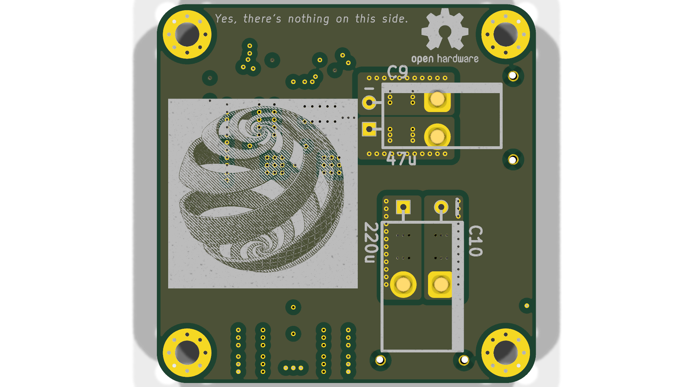

# PUDGALA 300
### High-Power-Density 250W Synchronous Buck Converter (28V–60V In → 24.88V @ 10A Out)

[](LICENSE)
[](https://kicad.org/)
[](https://en.wikipedia.org/wiki/Open-source_hardware)
[]()
[]()
[]()
[]()

> *"Ex umbra, in solem."* — [HEX Aerospace](https://hexaerospace.in)

---



## Overview & Motivation

The **PUDGALA 300** is an open-source, high-power-density synchronous buck converter developed with [HEX Aerospace](https://hexaerospace.in). It steps down wide-range DC voltages (nominal 36V–54V battery buses, 7S–14S LiPo / Li-ion packs) down to a regulated **24.88V (25V / 24V compatible)** rail delivering **10A continuous (250W nominal)**, and has been bench-tested up to **12.5A continuous (~312W)** with peak efficiency exceeding **96%**.

### Field FPV Charging
The primary motivation for this project was powering high-power FPV drone battery chargers directly from repurposed **13S electric scooter (E-scooter) battery packs** in the field.

* **The Problem:** 13S Li-ion battery packs swing from **39.0V** (empty) to **54.6V** (fully charged). However, most popular field chargers (such as ISDT, ToolkitRC, Hota, and SkyRC) have a maximum input voltage limit of **30.0V DC**. Connecting a 13S battery directly would instantly destroy the charger.
* **The Solution:** The PUDGALA 300 steps down the 39V–54.6V input into a stable **24.88V** rail at up to **10A–12.5A (>300W)**. This allows pilots to rapidly parallel-charge multiple 4S and 6S drone packs in the field using salvaged e-mobility batteries.

---

> [!CAUTION]
> ### Critical Operational Notice: Anti-Spark Connectors & Inrush Caution
> During early testing of the prototype, the board was connected to a high-voltage 13S battery (~54.6V) with an active load already plugged into the output. The raw XT60 connector sparked violently upon contact, and the severe inrush arc and inductive voltage spike exceeded the MOSFET breakdown rating, killing one of the switching FETs.
>
> **Mandatory Safe Operating Procedures:**
> 1. **Always Use Anti-Spark Connectors:** When connecting sources above 30V (especially 13S / 48V–54.6V packs), use an anti-spark connector with a built-in pre-charge resistor (such as **XT90-S** or **XT60-S**) or an external pre-charge switch.
> 2. **Power-On Sequence:** Always connect the battery input **first** with no output load connected. Confirm the output power indicator LED is on (verifying stable 24.88V regulation) **before** plugging in your charger.
> 3. **Lead Length:** Keep input battery leads as short as possible to minimize parasitic wiring inductance.

---

## Key Specifications

| Parameter | Specification | Notes / Conditions |
| :--- | :--- | :--- |
| **Input Voltage** | **28.0V to 60.0V DC** | Designed for 13S E-scooter packs (39V–54.6V), 7S–14S LiPo, 36V/48V buses |
| **Output Voltage** | **24.88V nominal (~25V)** | Calibrated via precision feedback divider (301 kΩ / 10 kΩ) |
| **Continuous Output Current** | **10.0 A (Nominal) / 12.5 A (Tested)** | 250W nominal; bench-tested to 312W continuous (requires active cooling) |
| **Peak / Overcurrent Limit** | **12.0 A peak** | Cycle-by-cycle limit with automatic hiccup restart |
| **Continuous Output Power** | **250 W nominal (up to 312 W)** | High continuous power density in a pocket-sized 50×50 mm board |
| **Switching Frequency** | **~1.0 MHz (966 kHz nominal)** | Programmed via 9.09 kΩ resistor |
| **Peak Efficiency** | **> 96%** | Typically 94.5%–96.2% across 36V–52V input range |
| **PCB Dimensions** | **50.0 mm × 50.0 mm × 12.0 mm** | Low profile; horizontal bent-lead electrolytic capacitors |
| **PCB Layer Stackup** | **6 Layers (1 oz / 35 µm Cu each)** | Solid internal GND reference planes on L2 & L5 |
| **Connectors** | **AMASS XT30PW-M (Right-Angle)** | High-current, vibration-resistant power in/out connectors |
| **Auxiliary Fan Header** | **2-pin test points (+Fan / -Fan)** | 24V regulated output for an active cooling fan |
| **Enclosure** | **CAD STEP File Coming Soon** | 3D-printable / CNC enclosure in progress |

---

## System Architecture & Block Diagram



---

## Component Analysis & IC Explanations

### 1. Primary Controller: Texas Instruments LM5149-Q1 (`U1`)
The **LM5149-Q1** (`PLM5149QRGYRQ1`) is an AEC-Q100 qualified, 80V/100V-capable synchronous buck DC-DC controller designed for high-efficiency, low-EMI industrial and automotive applications.
* **Dual-Random Spread Spectrum (DRSS):** Programmed via a 40.2 kΩ resistor (`R2`) on the `CNFG` pin. DRSS modulates the switching frequency to spread out noise energy and lower peak EMI spikes.
* **1.0 MHz Switching Frequency:** Set via a 9.09 kΩ resistor (`R1`) on the `RT` pin (~966 kHz nominal). Running at 1 MHz allows using a small 2.2 µH inductor and compact ceramic capacitors while keeping transient response fast.
* **PFM / Light-Load Efficiency:** The `PFM/SYNC` pin is tied directly to `VDDA`. Under light or no-load conditions, the controller automatically enters diode emulation to reduce idle battery drain.
* **Current Sensing & Protection:** Cycle-by-cycle current limiting using differential sense inputs (`ISNS+` and `VOUT/ISNS-`) across the shunt resistor, cutting off overcurrents at 12A with automatic hiccup restart under short circuits.
* **Gate Drivers & Internal VCC:** Built-in 5V regulator with a 2.2 µF bypass capacitor (`C8`), providing strong gate drive currents and adaptive deadtime control to prevent shoot-through.

---

### 2. High-Side Power MOSFET: TI CSD19534Q5A (`Q1`)
* **Package:** SON 5 mm × 6 mm (TDSON-8)
* **Key Ratings:** 100V, 44A continuous, 10.3 mΩ typical on-resistance
* **Why this part:** Chosen for its ultra-low gate charge (13.8 nC). At a high 1.0 MHz switching frequency, low gate charge is critical to keep switching losses minimal.

---

### 3. Low-Side Synchronous Rectifier MOSFET: TI CSD19502Q5B (`Q2`)
* **Package:** SON 5 mm × 6 mm (TDSON-8)
* **Key Ratings:** 80V, 138A, ultra-low 2.8 mΩ typical on-resistance
* **Why this part:** The low-side switch handles freewheeling current roughly 50% of the time. Its tiny 2.8 mΩ resistance keeps conduction heat minimal (~0.15W at 10A), allowing it to run cool without extra heatsinks.

---

### 4. Power Inductor: Chilisin BMRF00101040 (`L1`)
* **Value:** 2.2 µH, 20A saturation current
* **Why this part:** High 20A saturation rating provides clean headroom above the 12A peak limit. The fully shielded composite iron-powder core prevents radiated magnetic noise from interfering with nearby electronics.

---

### 5. Current Sense Shunt: 5 mΩ Metal Element 2512 (`R3`)
* **Value:** 5 mΩ (0.005 Ω), 1% tolerance, 2512 package
* **Operation:** Senses output current directly. Paired with the controller's 60 mV threshold, it sets the cycle-by-cycle peak limit to 12.0A. Connected using 4-wire Kelvin traces (`NT1`, `NT2`) to avoid PCB trace resistance errors.

---

### 6. Protection Clamps: SMBJ60A & SMBJ28A TVS Diodes
* **Input TVS (`D2` — SMBJ60A):** 60V standoff voltage clamp that absorbs inductive voltage spikes when connecting or disconnecting the battery.
* **Output TVS (`D3` — SMBJ28A):** 28V standoff voltage clamp that prevents the output from ever exceeding the 30V maximum input rating of downstream FPV chargers.
* **Fuse Recommendation:** Always install an inline 15A fuse on the positive battery lead (or use a battery pack with a short-circuit-protected BMS). If an overvoltage fault occurs, the TVS clamps the rail to ground and blows the fuse instantly, ensuring the charger never sees excessive voltage.

---

### 7. Capacitor Filtering Network
* **Input Bank:** Two 22 µF 2220 MLCCs (`C1`, `C2`) for high-frequency ripple, a 100 nF MLCC (`C14`) right at the high-side FET drain, and a 47 µF horizontal electrolytic (`C9`) to damp input line ringing.
* **Output Bank:** Four 10 µF 1210 MLCCs (`C4`, `C11`, `C12`, `C13`) yielding 40 µF of ultra-low ESR capacitance for low voltage ripple, plus a 220 µF horizontal electrolytic (`C10`) for transient load response.

---

## Operating Limits & Thermal Behavior

### 1. Continuous 12.5A Bench Testing
The PUDGALA 300 was successfully tested on the bench at **12.5 A continuous** at ~24.9V, delivering **~312 W output power**:
* **Thermal Rise:** Resistive heating increases significantly (+56%) when stepping up from 10A to 12.5A. In open still air at 12.5A, the bare board components quickly reach 90°C–100°C.
* **Cooling Requirement:** While the board handles 12.5A electrically, **active forced airflow or heatsink coupling is mandatory** for sustained operation above 10A.

### 2. Cooling Options
1. **Passive Air:** Suitable for continuous loads up to **100W–120W** (around 4A–5A).
2. **Forced Air Cooling:** Full **250W–300W+ continuous** rating when a 24V cooling fan is connected to the onboard `+Fan / -Fan` solder pads.
3. **Chassis / Heatsink Mounting:** The bottom side of the PCB has **no components** ("*Yes, there's nothing on this side*"). A 1.0 mm thermal silicone pad placed between the bottom ground plane and an aluminum enclosure or frame allows sinking heat directly into external metal.
4. **Protective Enclosure:** A custom 3D-printable / CNC enclosure STEP model with fan mounting and heatsink interface will be uploaded to this repository soon.

---

## 6-Layer PCB Stackup & Layout

The board uses a custom 6-layer FR4 stackup (1.6 mm thickness, 1 oz / 35 µm copper across all layers) optimized for low loop inductance and thermal dissipation.

| Layer | Type | Material | Thickness | Description & Key Nets |
| :--- | :--- | :--- | :--- | :--- |
| **Top (Layer 1)** | Copper | 1 oz Cu | 35 µm | Components, switching loop, gate drives, analog ground (`F.Cu`) |
| *Dielectric 1* | Prepreg | FR4 | 100 µm (0.10 mm) | Ultra-thin dielectric for tight RF coupling to ground |
| **Inner 1 (Layer 2)** | Copper | 1 oz Cu | 35 µm | **Solid Ground Plane** — immediate return path under L1 (`In1.Cu`) |
| *Dielectric 2* | Core | FR4 | 535 µm (0.535 mm) | Internal structural core |
| **Inner 2 (Layer 3)** | Copper | 1 oz Cu | 35 µm | Ground & auxiliary shielding plane (`In2.Cu`) |
| *Dielectric 3* | Prepreg | FR4 | 100 µm (0.10 mm) | Prepreg isolation layer |
| **Inner 3 (Layer 4)** | Copper | 1 oz Cu | 35 µm | **Power Planes** — +BATT input & +24V distribution (`In3.Cu`) |
| *Dielectric 4* | Core | FR4 | 535 µm (0.535 mm) | Internal structural core |
| **Inner 4 (Layer 5)** | Copper | 1 oz Cu | 35 µm | **Solid Ground Plane** — plane shielding & thermal spreading (`In4.Cu`) |
| *Dielectric 5* | Prepreg | FR4 | 100 µm (0.10 mm) | Prepreg isolation layer |
| **Bottom (Layer 6)** | Copper | 1 oz Cu | 35 µm | **Flat Ground Plane** — zero components, heatsink interface (`B.Cu`) |

*Total Board Thickness: 1.6 mm*

---

## Hardware Gallery

### Assembled & Bare PCB
| Populated SMD Board | Bare 6-Layer ENIG PCB |
| :---: | :---: |
|  |  |
| *Reflowed SMD components on hotplate* | *Bare 50x50 mm board with ENIG finish* |

### PCB Artwork & Stencil Inspection
| Copper Signature Detail | Silkscreen Motto & Fan Header | Solder Paste Deposition (Microscope) |
| :---: | :---: | :---: |
|  |  |  |
| *"Sid J" etched in top copper* | *"Ex umbra, in solem." & fan pads* | *Solder paste stencil on VQFN-24* |

### 3D CAD Renders & Schematic
| Isometric 3D View | Top Component Placement | Bottom Heatsink Plane |
| :---: | :---: | :---: |
|  |  |  |
| *3D isometric view* | *Component layout* | *Flat ground interface* |

> 📄 **Schematic:** Full vector schematic available at [`images/schematic.svg`](images/schematic.svg).

---

## Bill of Materials (BOM)

All components are standard, readily sourcable parts with matching **LCSC Part Numbers** for turn-key assembly via JLCPCB, PCBWay, or other assembly houses.

| Designator | Value / Part | Description | Package / Footprint | Qty | LCSC Part # |
| :--- | :--- | :--- | :--- | :---: | :--- |
| **U1** | **PLM5149QRGYRQ1** | TI 80V/100V Synchronous Buck DC-DC Controller with DRSS | VQFN-24 (4.5×3.5mm) | 1 | **C7528454** |
| **Q1** | **CSD19534Q5A** | TI 100V 44A 10.3mΩ N-Ch NexFET (High-Side Switch) | TDSON-8 / SON 5×6mm | 1 | **C114200** |
| **Q2** | **CSD19502Q5B** | TI 80V 138A 2.8mΩ N-Ch NexFET (Low-Side Sync Rectifier) | TDSON-8 / SON 5×6mm | 1 | **C2864118** |
| **L1** | **2.2u, 20A** | Chilisin BMRF00101040 Shielded Power Inductor | SMD 10×10×4.0mm | 1 | **C3002681** |
| **R3** | **5m (0.005Ω)** | Current Sense Shunt Resistor, 1%, 2W/3W | SMD 2512 | 1 | **C48982662** |
| **D2** | **SMBJ60A** | 600W 60V Unidirectional TVS Surge Diode | DO-214AA (SMB) | 1 | *Standard* |
| **D3** | **SMBJ28A** | 600W 28V Unidirectional TVS Overvoltage Diode | DO-214AA (SMB) | 1 | *Standard* |
| **J1** | **Power In** | AMASS XT30PW-M Right-Angle 2-Pin Male Connector | XT30PW-M Horizontal | 1 | *Standard* |
| **J2** | **Power Out** | AMASS XT30PW-M Right-Angle 2-Pin Male Connector | XT30PW-M Horizontal | 1 | *Standard* |
| **C1, C2** | **22u** | Ceramic Capacitor, 50V/100V, X7R | SMD 2220 | 2 | **C7499406** |
| **C4, C11, C12, C13** | **10u** | Ceramic Capacitor, 35V/50V, X7R | SMD 1210 | 4 | **C77102** |
| **C9** | **47u** | Low-ESR Radial Aluminum Electrolytic, 63V/100V (Horizontal) | Rad 8×15mm Horizontal | 1 | **C5110663** |
| **C10** | **220u** | Low-ESR Radial Aluminum Electrolytic, 35V/50V (Horizontal) | Rad 10×16mm Horizontal | 1 | **C95082** |
| **C3** | **100n** | Bootstrap Capacitor (CBOOT), 50V, X7R | SMD 0603 | 1 | **C15725** |
| **C14** | **100n** | High-Frequency Input Bypass, 100V, X7R | SMD 0603 | 1 | **C7499406** |
| **C5** | **1u** | VDDA Analog Bypass Capacitor, 16V, X7R | SMD 0402 | 1 | **C29266** |
| **C6** | **680p** | Loop Compensation Zero Capacitor, 50V, C0G/X7R | SMD 0402 | 1 | *Standard* |
| **C7** | **24p** | Loop Compensation HF Pole Capacitor, 50V, C0G | SMD 0402 | 1 | **C2171081** |
| **C8** | **2.2u** | VCC Gate Drive Bias Bypass, 16V, X7R | SMD 0805 | 1 | **C170101** |
| **R1** | **9k09 (9.09kΩ)** | Switching Frequency Resistor (1% tolerance, sets ~1MHz) | SMD 0402 | 1 | **C861611** |
| **R2** | **40k2 (40.2kΩ)** | Mode & Dual-Random Spread Spectrum Resistor (1%) | SMD 0402 | 1 | **C491131** |
| **R4** | **301k (301kΩ)** | Feedback Voltage Divider Upper Resistor (0.5% or 1%) | SMD 0402 | 1 | **C2981491** |
| **R5** | **10k (10.0kΩ)** | Feedback Voltage Divider Lower Resistor (0.5% or 1%) | SMD 0402 | 1 | **C95204** |
| **R6** | **5k9 (5.9kΩ)** | External Error Amplifier Compensation Resistor (1%) | SMD 0402 | 1 | **C491142** |
| **R7** | **100k (100kΩ)** | Power Good (PG) Pull-Up Resistor (1%) | SMD 0402 | 1 | **C122538** |
| **R8** | **11k5 (11.5kΩ)** | LED Current Limiting Ballast Resistor (~2mA @ 24V) | SMD 0805 | 1 | *Standard* |
| **D1** | **LED** | Green / Blue Status Indicator LED | SMD 0603 | 1 | **C46610608** |
| **+FAN, -FAN** | **+Fan / -Fan** | Keystone 5015 Micro-Mini Solder Test Points | TP Keystone 5015 | 2 | *Standard* |
| **H1, H2, H3, H4** | **M3 Holes** | Mounting Holes with Grounded Annular Pad & Via Array | 3.2mm M3 Pad | 4 | *Mechanical* |
| **NT1, NT2, NT3** | **NetTie_2** | Kelvin-Sense & AGND Star Ground Isolation Net Ties | Net Tie SMD | 3 | *PCB Feature* |

> An interactive browser-based BOM with cross-probing component highlighting is located at [`250W Bat/bom/ibom.html`](250W%20Bat/bom/ibom.html).

---

## Manufacturing & Fabrication Guide

### PCB Fabrication Parameters
* **Layers:** 6
* **Board Dimensions:** 50.0 mm × 50.0 mm
* **Corner Radius:** 4.0 mm
* **PCB Thickness:** 1.6 mm
* **Copper Weight:** 1 oz outer / 1 oz inner (35 µm Cu across all 6 layers)
* **Surface Finish:** ENIG (Electroless Nickel Immersion Gold) recommended for high-current pads and flat thermal contact; Lead-Free HASL is acceptable.
* **Solder Mask:** Green (or Matte Black)
* **Silkscreen:** White
* **Minimum Trace / Space:** 0.15 mm / 0.15 mm (6 mil / 6 mil)
* **Minimum Drill:** 0.3 mm (via hole) / 0.5 mm (via pad)

### Production Files
All fabrication and assembly deliverables are located in the [`250W Bat/production/`](250W%20Bat/production/) directory:
* **Gerbers & Drill Archive:** [`250W_Bat.zip`](250W%20Bat/production/250W_Bat.zip)
* **BOM File:** [`bom.csv`](250W%20Bat/production/bom.csv)
* **Pick-and-Place (CPL) Centroid:** [`positions.csv`](250W%20Bat/production/positions.csv)
* **Netlist:** [`netlist.ipc`](250W%20Bat/production/netlist.ipc)
* **3D CAD STEP Model:** [`Converter.step`](250W%20Bat/Converter.step) & [`board.step`](250W%20Bat/board.step)

---

## Repository Structure

```
├── LICENSE                         # MIT Open Source License
├── README.md                       # Main project documentation (this file)
├── images/                         # Project graphics, renders, and diagrams
│   ├── pcb_3d_isometric.png        # Raytraced 3D perspective view
│   ├── pcb_3d_top.png              # Raytraced top component view
│   ├── pcb_3d_bottom.png           # Raytraced bottom ground plane view
│   ├── schematic.svg               # Vector schematic export
│   └── irl/                        # Real-world hardware photography
│       ├── README.md               # Photography index and descriptions
│       ├── pcb_bare_board.jpg      # Studio shot of bare ENIG PCB
│       ├── pcb_smd_assembled.jpg   # Populated SMD board post-reflow
│       ├── pcb_signature_detail.jpg# Macro of "Sid J" signature
│       ├── pcb_motto_detail.jpg    # Macro of "Ex umbra, in solem." & fan pads
│       └── microscope_solder_paste_qfn.jpg # Microscope view of VQFN-24 solder paste
└── 250W Bat/                       # KiCad design directory
    ├── 250W Bat.kicad_pro          # KiCad Project file (KiCad v10)
    ├── 250W Bat.kicad_sch          # Main schematic sheet
    ├── 250W Bat.kicad_pcb          # 6-layer board layout
    ├── Converter.step              # Full 3D STEP CAD assembly
    ├── board.step                  # Bare PCB 3D STEP file
    ├── bom/
    │   └── ibom.html               # Interactive HTML Bill of Materials
    └── production/                 # PCBA manufacturing outputs
        ├── 250W_Bat.zip            # Gerber & Excellon drill files
        ├── bom.csv                 # Production BOM with LCSC part numbers
        ├── positions.csv           # SMT pick-and-place centroid data
        └── netlist.ipc             # IPC-D-356 electrical test netlist
```

---

## Author & License

* **Author / Design:** Siddesh Jain
* **License:** Licensed under the permissive **[MIT License](LICENSE)**. You are free to use, modify, distribute, and manufacture this hardware for academic, hobbyist, and commercial projects.
